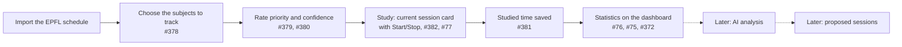

<!-- Co-authored-by: Claude Opus 5.5 <noreply@anthropic.com> -->

# Statistics flow: decisions

This document collects what we agreed on for the statistics flow and the decisions still open.
It builds on the wiki page [M3 Statistics flow plan](https://github.com/DidYouStudy/App/wiki/M3-Statistics-flow-plan), as last updated on Friday 20 November 2026, which we take as the agreed basis.

## How to review

- Each open decision has its own short section below. Comment on its line: agree, disagree, or propose another option.
- The PO settles each decision. Once settled, the decision's thread is resolved and the section says **Decided**.
- Please answer by **Tuesday 24 November 2026**, so that the blocked Sprint 7 tasks can start.
- Implementation details (colours, padding, names) stay with the developer of each task. Only choices that change what the app does or stores are listed here.
- When the PR merges, the issues and the wiki plan are updated to match this document.

## The flow

Solid arrows are the Sprint 7 scope. Dotted arrows are later Sprints.

## Already agreed

| Topic | Agreement | Tasks |
|---|---|---|
| Tracked subjects | At schedule import, the student ticks the subjects to track. Decisions live in their own document, `users/{uid}/meta/trackedSubjects`, separate from the subject catalog, keyed like the catalog. | #371, #378 |
| Subject scores | Stored per tracked subject, next to its tracked flag. | #379, #380 |
| Studied time | Stored in its own repository, `SessionFeedbackRepository`, at `users/{uid}/feedback/{eventId}`, never inside `PersonalEvent` (its KDoc says it describes planned time only). | #381 |
| Task counts | Read from `PersonalEvent.tasks` when needed, not stored again. Group sessions have no tasks. | #381 |
| Current session | A dashboard card for the session happening now, with a ring for study and break periods computed from the user's break preferences (`UserPreferences.breakFrequencyMinutes` and `breakLengthMinutes`). | #382, #77 |
| Statistics storage | No new repository: statistics are computed from the events and the feedback records. | #76 |
| AI calls | No API key in the APK, since it can be extracted. Calls go through a backend that holds the key. | later |

## Open decisions for Sprint 7

The IDs D1 to D6 are the ones of the wiki page [Task graph: Sprint 7](https://github.com/DidYouStudy/App/wiki/Task-graph-Sprint-7). D7 to D11 are new.

### D1. Which event types are concerned

This is three separate questions, and the issues answer them differently today:

| Question | Today in the issues |
|---|---|
| Which types get a current session card | Every type (#382, #77) |
| Which types can be recorded with Start/Stop | `STUDY_SESSION` only (#77) |
| Which types count in the statistics | `STUDY_SESSION` and `EXERCISE_SESSION` (#76) |

As written, exercise sessions count in the statistics but can never be recorded, so their time could only come from the planned times.
User story #5 asks for "hours studied on exercises and hours reviewed the theory for each subject", which needs exercise sessions to be counted separately.

**Recommendation:** a card for every type; Start/Stop and statistics for `STUDY_SESSION` and `EXERCISE_SESSION`, shown separately in the statistics (study and exercises). Recording one more type costs one condition in #77.

**Blocks:** #382, #77, #76.

### D2. How studied time is entered

Options: a Start/Stop toggle on the card, a +/- stepper, or a prompt at the end of the session.

**Recommendation:** a Start/Stop toggle, as every issue already assumes.

**Blocks:** #381, #77.

### D3. Shape of a record

Options: one start and one stop per session, or several start/stop intervals.

**Recommendation:** one start and one stop per session, stored in whole seconds. The start time is stored when Start is tapped, so a running session survives the app being closed. Start is available only while the session is current; Stop is available at any time after Start, even after the official end.

**Blocks:** #381, #77.

### D4. One ring or two

Options: one ring that switches between study and break, or one ring for the session and one for the break.

**Recommendation:** one ring that switches mode, as drafted on Figma.

**Blocks:** #382, #77.

### D5. Overlapping sessions

Options: one card per overlapping session, or only the first one.

**Recommendation:** one card per session, each with its own toggle and record. In the statistics, recorded time that overlaps is counted once (the union of the recorded intervals), so studying during two overlapping sessions does not double the time.

**Blocks:** #382, #77, #76.

### D6. Which scores per subject

Options: priority and confidence; or also difficulty. A weekly reminder to update them, or none.

**Recommendation:** priority and confidence, each from 1 to 10, no difficulty (it says the same as confidence), and no weekly reminder for now.

**Blocks:** #379, #380.

### D7. What "study time" means in the statistics

Options: the recorded time only; or the recorded time, with the planned time when a session was never started.

Mixing the two hides whether the student really studied.

**Recommendation:** show both, separately: "planned" from the events and "done" from the records. A session never started counts as planned, with 0 done. This gives the "planned vs done" view that epic #292 asks for.

**Blocks:** #76, #75, #372.

### D8. What "average focus duration" means

#75 asks for it. #76 proposes that the student reports it; the wiki plan suggests the recorded time, which would be the same as the study time.

**Recommendation:** the average recorded duration of the sessions that were started, over the week. Nothing more is asked from the student.

**Blocks:** #76, #75.

### D9. Subjects that do not come from an import

Already decided in #371 and #378: only subjects ticked at import are tracked; a subject typed by hand is never tracked.

Consequence: a student who never imports the EPFL schedule never gets any statistics, and a group session counts only when its subject, typed by the host, matches a tracked subject exactly.

Options:
- (a) keep it as decided;
- (b) when an event is saved with a subject never decided, ask "Track this subject?" once;
- (c) track every new subject by default, untracking from Preferences.

**Recommendation:** keep (a) for Sprint 7, so #371 and #378 do not change, and plan (b) as a small follow-up task. The PO should confirm that statistics without an import are not needed for the M3 demo.

**Blocks:** nothing in Sprint 7; decides a follow-up task.

### D10. Recording group sessions

#381 records group and individual sessions; #77 hides the toggle for group sessions.

**Recommendation:** the repository (#381) accepts both, since each record is per user; the card (#77) hides the toggle for group sessions in Sprint 7, and a later task enables it.

**Blocks:** #381, #77.

### D11. What a feedback record stores

#381 stores `eventId`, `subject`, `startedAt` and `studiedSeconds`. Personal events and group sessions live in two collections, so the statistics need to know where to find the event of a record (its type and planned times).

**Recommendation:** also store the event kind (personal or group session). A record whose event was deleted is ignored by the statistics and kept in storage.

**Blocks:** #381, #76.

### D12. Statistics window and placement

Options for the window: the current week, month, or all time. Options for the placement: cards on the dashboard, a separate screen, or both.

**Recommendation:** the dashboard cards (#75) show the current week, Monday to Sunday in the device's time zone (clock and zone injected, so tests pass in any time zone). The statistics screen (#372) with week, month and all time comes after the cards.

**Blocks:** #76, #75, #372.

## Contradictions to fix in the issues

These are fixed in the issues after this PR merges, according to the decisions above.

1. **#77** adds the studied time to `PersonalEvent.studyRecord` with `EventsRepository.startStudyRecord`, which contradicts the agreed `SessionFeedbackRepository` (#381). #77 must use #381's interface.
2. **Group sessions:** #381 records them, #77 hides the toggle (D10).
3. **Exercise sessions:** counted by #76 but not recordable in #77 (D1).
4. **#381** still refers to the codes C1, C5, C6, C7 and R1 of an older version of the plan. Replace them with the IDs of this document.
5. **#75 and #373** both describe the statistics cards on the dashboard, and #373 has no description. Keep one.
6. **#77** says High (480) in its Size section but 120 on the board.

## Later Sprints

Not decided now. Listed so that nothing is lost.

### AI analysis

- Which model to use.
- Where the call runs: a backend that holds the key, for example a Cloud Function. Check that our Firebase plan allows it.
- Which data is sent (subjects, times, scores) and whether the student must agree first, since it leaves the app.
- When the analysis runs (on demand, nightly, after a number of sessions) and how long its results are kept.

### Proposed sessions

- Where proposals are shown: on the calendar with a distinct style, or in a separate list.
- Where they are stored: in their own model and repository, not in `PersonalEvent`, so they do not appear in the calendar and the statistics before being accepted.
- How a proposal is accepted (turned into a `PersonalEvent`) or dismissed.
- Which period proposals cover (for example the next week).
- Whether group sessions can be proposed, or only individual sessions.

## Decision and task map

| Task | Waits for |
|---|---|
| #371 Tracked subjects repository | nothing (D9 confirms it unchanged) |
| #378 Subject confirmation dialog | #371 |
| #379 Scores per subject | #371, D6 |
| #380 Rate tracked subjects | #378, #379, D6 |
| #381 Session feedback repository | D2, D3, D10, D11 |
| #382 Current sessions | D1, D4, D5 |
| #77 Current session card | #381, #382, #371, D1 to D5, D10 |
| #76 Statistics backend | #381, #378, D1, D5, D7, D8, D11, D12 |
| #75 Statistics cards | #76, D7, D8, D12 |
| #372 Statistics screen | #76, D12 |
