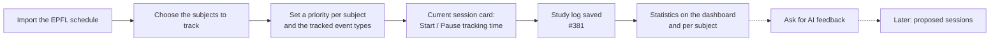

<!-- Co-authored-by: Claude Opus 5.5 <noreply@anthropic.com> -->

# Statistics flow: decisions

This document records what the team decided for the statistics flow, and what is still open.
It builds on the wiki page [M3 Statistics flow plan](https://github.com/DidYouStudy/App/wiki/M3-Statistics-flow-plan).
The decisions come from the review threads of this PR (22 to 27 November 2026), the review of PR #407, and the team meeting of 27 November 2026 (five members).

## How to use this document

- Each decision says what was decided and where.
- The open points at the end still need the PO's answer. Please comment on their line.
- Implementation details (colours, padding, names) stay with the developer of each task.

## The flow

Solid arrows are decided. Dotted arrows are later work.

## Decided

### D1. Which event types count

- Only **personal events** count. Group sessions are not tracked for now (see D10).
- For each tracked subject, the student chooses in **Preferences** which event types count. The default selection is `STUDY_SESSION`, `COURSE`, `EXERCISE_SESSION`, `LAB` and `PROJECT` (every type except `EXAM` and `OTHER`), and the student can change it later.
- Study sessions and exercise sessions are not separated in the statistics. User story #5 will be updated.
- Every event gets a current session card. **Start tracking time** and **Pause tracking time** only show for tracked types (hidden or greyed out otherwise). **Start now** and **End event** show for every type.

Source: Maria and Steven on this PR; wiki plan.

### D2. How studied time is entered

- **Start tracking time** and **Pause tracking time** buttons on the current session card record the focus time. A short cooldown on these buttons avoids inconsistent tracking when they are tapped very quickly.
- **Start now** (on the "Your day" card) starts an event early. It moves the event's start time through the edit event functions, but it does **not** start tracking: the student still taps **Start tracking time**.
- **End event** (on the current session card) asks for confirmation, then stops tracking and ends the event. It moves the event's end time through the edit event functions.

Source: Daniel and Maria on this PR; team meeting of 27 November.

### D3. Shape of a record

Several focus intervals per session (each with a start and an end); the gaps are breaks. The record is the study log of PR #407 (see D11).

### D4. The ring

- One ring per current session card, coloured by event type.
- Full colour shows the periods the student was tracking; a dashed interior shows the breaks.
- Suggested breaks still alternate with study periods, from the student's preferences. The student is alerted when a suggested break starts but can keep studying. During a suggested break, the ring starts again from the top and the card shows the time left in the break.
- Follow the current session card mockup on Figma.

Source: Yuhan and Maria on this PR.

### D5. Overlapping sessions on the dashboard

One card per session, the one whose subject has the highest priority first; swipe to see the others. Show only the three top tasks, in a scrollable list.

Source: Yuhan on this PR. Counting overlapping time in the statistics is still open (see open point 1).

### D6. Scores per subject

A **priority** set by the student, on the Preferences screen (design on Figma). No confidence or difficulty score.

### D7. What "study time" means

The **recorded focus time**: the sum of the tracked intervals. This is the "Average daily study time" of the Figma stats card. A session that was never tracked counts as 0.

It is affected by Start now and End event (they move the event and stop tracking, see D2) and by the Start / Pause tracking time buttons, which alone start and stop the recording.

Source: team meeting of 27 November; wiki plan.

### D8. Focus score

A **percentage**: the recorded focus time divided by the planned focus time, where the planned focus time is the planned duration minus the suggested breaks (from the student's preferences).

Example: 60 minutes planned with one 10-minute suggested break gives 50 minutes of planned focus; 40 minutes recorded gives **80 %**.

"Average focus duration" must be added to the current dashboard mockups on Figma.

Source: Daniel on this PR; team meeting of 27 November; wiki plan. The wiki says "against the total planned studying time": whether that already excludes the suggested breaks is open point 3.

### D9. Subjects that do not come from an import

When an event uses a subject that was never decided, the app asks the student whether to track it. The subject picker of the event form also lists the tracked subjects, even when no event uses them yet.

Source: Yuhan on this PR; wiki plan.

### D10. Group sessions

Not tracked for now, for simplicity: they have no tasks, and their value for one student is hard to judge without explicit feedback.

Source: Daniel, Maria and Yuhan on this PR.

### D11. What a study log stores

Decided in the review of PR #407 and implemented there: `StudyLog` (renamed from "session feedback", since "feedback" is kept for the AI) with the event ID, event type, subject, planned start and end (frozen at creation), the focus intervals, a snapshot of the event's tasks (name and completion time) and an optional comment. `observeLogs(ownerId, from, to)` reads the logs of a period for the statistics.

### D12. Where the statistics are shown

- The **dashboard** shows the statistics of the ongoing event.
- A **See more** link opens the list of the student's subjects. Choosing one opens a **screen for that subject or course**, with a button per week to filter.
- Each course card can be opened for more details: rings per week, overall perceived difficulty, AI feedback.

Source: team meeting of 27 November; Daniel on this PR.

### Notifications

- 5 minutes before the start of an event;
- Whenever a suggested break starts;
- Whenever a suggested break time ends and the study time begins again;
- At the end of the event.
- Suggested breaks are sent as a notification to take a break; they are never mandatory.

Source: team meeting of 27 November. Task #392 covers part of it and needs an update.

### Text feedback and AI feedback

- The student can write a text comment on a past session, in a dialog from Event Details (#401). It is stored in the study log.
- AI feedback is only generated on demand, with an **Ask for AI feedback** button, never automatically.

Source: Yuhan on this PR; team meeting of 27 November.

## Still open

1. **Overlapping time in the statistics.** When two tracked sessions overlap, is their focus time counted once or twice? Suggestion: once, so one hour of study never counts as two.
2. **Start now and the frozen plan.** Start now moves the event's start time. If the study log is created after that (at the first Start tracking time), its frozen `plannedStart` is the new time and the original plan is lost, which changes the focus score (D8). Should the log keep the original planned times?
3. **Focus score details.** The denominator: the planned duration minus the suggested breaks (Daniel), or the whole planned duration (wiki)? And the edge cases: a session shorter than one focus period, and a session never tracked: 0 % or left out of the average?
4. **Perceived difficulty** (D12 course details): where does it come from, since no difficulty score is collected (D6)?
5. **AI feedback.** Which model; where the call runs (key in the app, Firebase AI Logic or Cloud Functions, see Steven's comparison on this PR); how long results are kept; whether the student can give feedback by microphone.
6. **Proposed sessions.** Where they are shown, how they are accepted or dismissed, which period they cover. (Decided in the wiki plan: they are stored in their own model and repository, not in `PersonalEvent`.)
7. **Study log storage (part 2 of #381).** The Firestore path: `users/{uid}/feedback/{eventId}` as written in #381, or `users/{uid}/studyLogs/{eventId}` after the rename.
8. **Task limit.** Events have no maximum number of tasks, while a study log keeps at most 50: add the same limit to the event form.

## Issues to update

- **#77** (current session card): Start / Pause tracking time, Start now, End event with confirmation, the ring of D4, the cooldown, and the `StudyLogRepository` API of #407.
- **#76** (statistics backend): D7 and D8, the tracked types per subject (D1), personal events only.
- **#75** (dashboard cards) and **#372** (statistics screen): D8 percentage and D12 layout.
- **#392** (notifications): the three notifications and the suggested breaks above.
- **#381** part 2: the Firestore path (open point 7).
